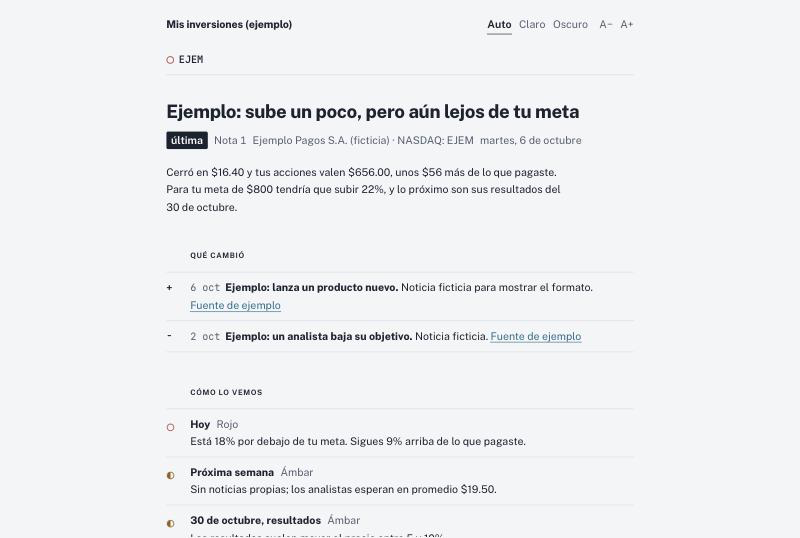
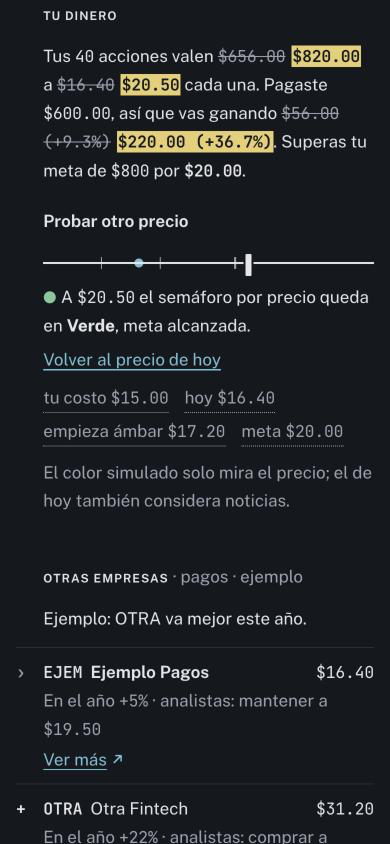

# market-brief

Una nota diaria, escrita en lenguaje simple, sobre las acciones que tienes. Tu agente de IA busca el precio y las noticias, aplica **tus** reglas (tu costo, tu meta de venta) y te la entrega como prefieras: una página web, un correo, ambas o solo notas en tu carpeta.

Es una *skill* en el formato abierto Agent Skills: funciona en Claude (Code y app de escritorio), Codex, Cursor, Gemini CLI, GitHub Copilot y cualquier agente que lea `SKILL.md`.

> No es asesoría financiera. La skill nunca compra ni vende: solo te cuenta qué pasó y qué tan cerca estás de tu meta.

| Página (claro) | Página en el celular (oscuro, simulando un precio) |
|---|---|
|  |  |

*Capturas con la empresa ficticia del ejemplo.* Abre [`examples/web/index.html`](examples/web/index.html) para probar la página y [`examples/correo-ejemplo.html`](examples/correo-ejemplo.html) para ver el correo.

## Qué te da cada día
- **Un titular y dos frases** con lo que pasó y qué tan lejos estás de tu meta.
- **Qué cambió**: las noticias que explican el movimiento, con su fuente.
- **Tres semáforos** según tus reglas: hoy, la próxima semana y el próximo evento (por ejemplo, resultados).
- **Tu dinero**: cuánto vale tu posición frente a lo que pagaste, y un **simulador** para probar otros precios.
- **Otras empresas** del sector, con un enlace para ver más sin cargar la página.
- **Notas anteriores**, para ver cómo ha ido.

Una sola skill sirve para todas tus empresas; cada empresa es una carpeta con su configuración.

## Empieza en 3 pasos

**1. Instala la skill**
```bash
npx skills add JoelBerus/market-brief
```
o clona el repositorio y enlázala en tus agentes:
```bash
git clone https://github.com/JoelBerus/market-brief.git && cd market-brief && ./install.sh
```
Carpetas de cada agente e instalación manual: [`references/agentes.md`](skills/market-brief/references/agentes.md).

**2. Configúrala**: edita `~/.config/market-brief/config.yaml` (el instalador deja una copia de [`config.example.yaml`](skills/market-brief/config.example.yaml)). Lo mínimo: la carpeta de `datos`, los `canales` y tu correo.

**3. Da de alta tu primera empresa** y pide la primera nota:
> «Quiero seguir NVDA con market-brief»

El agente investiga lo que puede y te pregunta solo lo que falta (cuántas acciones, cuánto pagaste, tu meta). Si lo dejas a medias, retómalo luego con «sigamos con el alta de NVDA». Después:
> «market-brief para NVDA»

## Elige cómo recibirla

| Quiero… | `canales.web` | `canales.correo` |
|---|---|---|
| Solo una página que abro cuando quiero | `html` o `artifact` | `no` |
| Solo el correo | `no` | `si` |
| Un correo corto y la página con todo | `html` o `artifact` | `si` |
| Solo notas en mi carpeta (Obsidian, Git…) | `no` | `no` |

- **`artifact`**: página privada en claude.ai que se actualiza sola. Solo con agentes Claude.
- **`html`**: un archivo HTML autocontenido. Ábrelo en tu computadora o publícalo (GitHub Pages, Netlify…). Funciona con cualquier agente.
- **Correo**: por empresa puedes elegir `siempre`, `cambios` (solo cuando cambia el semáforo, se cumple la meta o hay alerta) o `nunca`.

Detalles: [`references/canales.md`](skills/market-brief/references/canales.md).

## Programarla
- **App de Claude**: crea una tarea programada con el prompt «Usa la skill market-brief para NVDA y genera la nota diaria».
- **Cualquier CLI con cron**: `0 8 * * 1-5  claude -p "Usa la skill market-brief para NVDA"` (o `codex exec …`, `gemini -p …`).

## Tus datos
Todo vive en tu carpeta, en Markdown y JSON que puedes leer y versionar:
```
<datos>/
  NVDA/
    empresa.md          # tu configuración: acciones, costo, meta, comparables, correo
    Historial.md        # una fila por día
    Reportes/2026-10-21.md
  web/                  # solo con web: html (los JSON de la página)
```
¿Ya llevas tus posiciones en una tabla? Apunta `portafolio` a ese archivo y market-brief leerá de ahí las acciones, el costo y la meta. ¿Usas Obsidian? Pon `datos` dentro de tu bóveda.

Tu `config.yaml` y tu carpeta de datos nunca van al repositorio. Si publicas la página `html` en un sitio público, cualquiera con el enlace verá tus posiciones.

## Hazla tuya
Todo es texto: cambia colores, letras, secciones de la página, el correo, las reglas del semáforo, el tono o el idioma. Guía: [`references/personalizar.md`](skills/market-brief/references/personalizar.md). El sistema visual está en [`assets/DESIGN.md`](skills/market-brief/assets/DESIGN.md).

**¿Una skill por empresa?** No hace falta. Si tu agente la necesita (por ejemplo, para invocarla por nombre), copia [`assets/skill-empresa.md`](skills/market-brief/assets/skill-empresa.md): son 10 líneas que delegan en market-brief, así no se repite nada.

## Estructura
```
skills/market-brief/
  SKILL.md              # instrucciones para el agente
  config.example.yaml
  assets/               # hub.html (página), email.html, empresa.md, skill-empresa.md, DESIGN.md
  scripts/              # validar.py, build_page.py, render_email.py (Python estándar)
  references/           # configuracion, canales, datos, alta, personalizar, agentes
examples/               # empresa ficticia, página y correo generados
AGENTS.md               # para agentes que no leen skills
install.sh
```

## Preguntas frecuentes
- **¿Necesito Python?** Solo para el canal `html` y para rellenar el correo con los scripts. Sin Python, el agente puede hacerlo a mano siguiendo las mismas plantillas.
- **¿De dónde salen los precios?** De búsquedas web del agente; por defecto prioriza StockAnalysis. Puedes cambiar las `fuentes`. Si una fuente falla, usa otra y nunca inventa cifras.
- **¿Otras monedas o mercados?** Funciona con cualquier ticker que el agente encuentre. Las plantillas muestran `$`; cámbialo en `assets/` si usas otra moneda.

## Licencia
MIT. Ver [LICENSE](LICENSE).

---

**English summary.** *market-brief* is an Agent Skill (Claude, Codex, Cursor, Gemini CLI, Copilot…) that writes a plain-language daily note about the stocks you hold: price, what happened and why, three traffic lights against your own sell target, peers, and a price simulator. Delivery is up to you: a claude.ai Artifact page, a static HTML page, an email, or just Markdown notes. One skill for every company; each company is a folder with its own config. Templates and copy are in Spanish; see `references/personalizar.md` to translate. Not financial advice.
